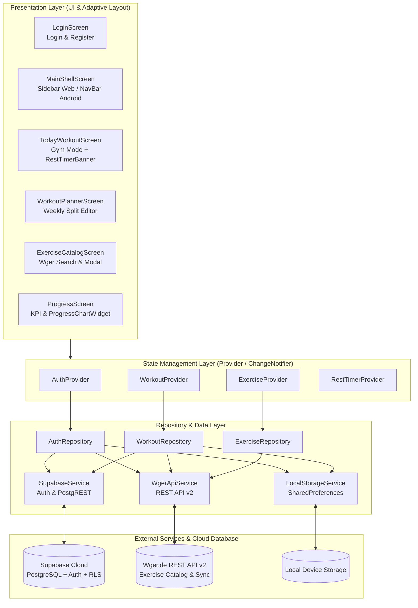
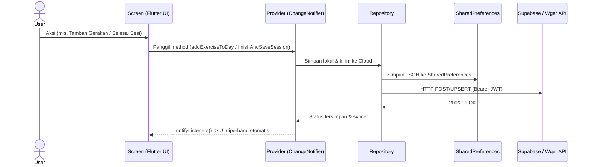

# DOKUMENTASI RANCANGAN & IMPLEMENTASI PROYEK
## FitLog Pro — Pelacak Latihan Gym & Rencana Olahraga Personal (Multi-Platform)

---

## 1. Analisis Permasalahan

### 1.1 Latar Belakang dan Permasalahan
Banyak pelaku olahraga gym — baik pemula maupun menengah — mengalami kesulitan dalam menjaga konsistensi latihan karena beberapa masalah umum:
1. **Perencanaan latihan tidak terstruktur:** Jadwal latihan otot mingguan (*Workout Split* seperti Push/Pull/Legs) sering hanya dicatat di catatan HP atau diingat-ingat, sehingga mudah lupa target set, repetisi, dan beban terakhir.
2. **Kesulitan mencari referensi gerakan otot yang tepat:** Pemula sering bingung memilih gerakan yang sesuai dengan kelompok otot target (Chest, Back, Legs, Shoulders, Arms, Abs) serta peralatan yang tersedia di gym.
3. **Pelacakan progres beban (*progressive overload*) yang rumit:** Tanpa grafik perkembangan volume latihan dan beban maksimal (*Personal Record / PR*), pengguna sulit menilai apakah performanya meningkat dari minggu ke minggu.
4. **Pengalaman lintas perangkat yang terputus:** Menyusun jadwal mingguan dan melihat grafik jauh lebih nyaman di layar besar (**Web / Laptop di rumah**), sedangkan saat di gym pengguna membutuhkan tampilan ringkas di **Android** yang fokus pada checklist set dan **Rest Timer** antar set.

### 1.2 Identifikasi Pengguna dan Kebutuhan Pengguna
- **Pengguna Pemula Gym:** Membutuhkan katalog gerakan otot lengkap dengan ilustrasi, nama otot target, dan panduan singkat agar tidak salah teknik.
- **Pengguna Rutin / Menengah:** Membutuhkan penyusun jadwal *Workout Split* mingguan, pencatatan beban (kg) & repetisi per set, Rest Timer otomatis antar set, serta grafik progres volume & beban maksimal.
- **Kebutuhan Lintas Platform:** Data akun, jadwal, dan riwayat latihan harus tersinkronisasi otomatis antara **Web (di rumah)** dan **Android (di gym)**.

### 1.3 Tujuan Pengembangan Aplikasi
1. Membangun aplikasi **FitLog Pro** berbasis Flutter multi-platform (**Web & Android**) dengan antarmuka adaptif bertema **Biru & Putih** yang modern dan interaktif.
2. Menyediakan sistem autentikasi pengguna (Daftar Akun & Login) serta penyimpanan cloud real-time menggunakan **Supabase (PostgreSQL + Auth)** agar jadwal dan progres tersinkronisasi lintas perangkat.
3. Mengintegrasikan **Wger Workout Manager REST API v2** sebagai katalog ratusan gerakan otot beserta ilustrasi dan kategori ototnya.
4. Menyediakan fitur **Gym Companion Mode** di Android (checklist set selesai + **Rest Timer** otomatis) dan **Home Planner Mode** di Web (perencanaan *Workout Split* + **Grafik Progres** interaktif).

### 1.4 Batasan dan Ruang Lingkup Solusi
- **Platform Target:** Web (Chrome/Desktop Browser) dan Android (Smartphone).
- **Fokus Fitur:** Autentikasi akun, penyusunan jadwal *Workout Split* 7 hari, katalog gerakan Wger dengan pencarian & filter otot, mode latihan harian dengan Rest Timer, serta analitik grafik progres & riwayat sesi.
- **Di luar Ruang Lingkup:** Pelacakan nutrisi/kalori harian, integrasi sensor *wearable* (smartwatch Bluetooth), dan fitur media sosial antar pengguna.

---

## 2. Analisis Kebutuhan Sistem

### 2.1 Kebutuhan Fungsional
| Kode | Kebutuhan Fungsional | Implementasi di Proyek |
| :--- | :--- | :--- |
| **KF-01** | Pengguna dapat mendaftar akun baru dan login dengan Email & Password | `LoginScreen`, `AuthProvider`, `SupabaseService.signUp/signIn` |
| **KF-02** | Pengguna dapat menyusun, mengubah, dan menyimpan jadwal *Workout Split* 7 hari (Senin–Minggu) termasuk *Rest Day* | `WorkoutPlannerScreen`, `WorkoutProvider`, tabel `workout_plans` |
| **KF-03** | Pengguna dapat mencari & memfilter katalog gerakan otot dari Wger API beserta ilustrasi & detail otot target | `ExerciseCatalogScreen`, `ExerciseProvider`, `WgerApiService` |
| **KF-04** | Pengguna dapat menambahkan gerakan dari katalog langsung ke hari tertentu di jadwal mingguan | Modal detail di `ExerciseCatalogScreen` → `WorkoutProvider.addExerciseToDay` |
| **KF-05** | Pengguna dapat membuka jadwal hari ini, mengubah beban/repetisi per set, dan mencentang set yang selesai | `TodayWorkoutScreen`, `WorkoutProvider.updateActiveSet` |
| **KF-06** | Sistem menjalankan **Rest Timer** otomatis setiap set dicentang, dengan kontrol `-15s`, `Pause/Resume`, `+15s`, `Skip` | `RestTimerProvider`, `RestTimerBanner` |
| **KF-07** | Pengguna dapat menyimpan sesi latihan selesai dan melihat grafik perkembangan volume & beban maksimal (PR) | `ProgressScreen`, `ProgressChartWidget`, tabel `workout_sessions` |
| **KF-08** | Pengguna dapat melihat profil, statistik ringkas, mengganti tema, dan keluar dari akun | Sidebar kiri & Modal Profil di `MainShellScreen` |

### 2.2 Kebutuhan Nonfungsional
- **Responsif & Adaptif:** Tata letak otomatis menyesuaikan lebar layar (`width >= 900px` untuk Web Desktop, `width < 900px` untuk Android/Mobile).
- **Keamanan Data:** Autentikasi berbasis JWT (Supabase Auth) dan **Row Level Security (RLS)** di PostgreSQL sehingga setiap user hanya dapat mengakses data miliknya sendiri (`auth.uid() = user_id`).
- **Ketersediaan Offline / Cache:** Data jadwal dan riwayat tetap tersimpan lokal di `SharedPreferences` sehingga aplikasi tetap dapat digunakan saat sinyal di gym lemah, lalu disinkronkan saat online.
- **Performa & Estetika:** Transisi halus (`AnimatedSwitcher`), feedback animasi *shake* saat validasi error, dan tema Biru & Putih berkontras tinggi agar nyaman dibaca di ruang gym terang.

### 2.3 Daftar Fitur Utama dan Prioritas Pengembangan
- **Prioritas 1 (Wajib / Core):** Autentikasi (Login & Register Supabase), Jadwal Split Mingguan, Katalog Gerakan Wger, dan Penyimpanan Cloud + Lokal.
- **Prioritas 2 (Inti Gym):** Mode Latihan Hari Ini (Checklist Set, edit kg/reps) dan Rest Timer Otomatis.
- **Prioritas 3 (Analitik & UX):** Grafik Progres Interaktif (Volume & Beban Maksimal per gerakan), Profil Pengguna, dan Responsive Adaptive Layout Web/Android.

### 2.4 Skenario Penggunaan Aplikasi
1. **Skenario A — Perencanaan di Rumah (Web):**
   Pengguna membuka FitLog Pro di browser → Login / Daftar Akun → masuk ke tab **Jadwal Split** → membuka **Katalog Wger** → memfilter kategori *Chest* → memilih *Barbell Bench Press* → klik **Tambah ke Jadwal** hari Senin (4 set × 8 reps, 60 kg) → data otomatis tersimpan ke Supabase PostgreSQL.
2. **Skenario B — Eksekusi di Gym (Android):**
   Pengguna membuka FitLog Pro di HP Android → Login dengan akun yang sama → otomatis masuk ke tab **Latihan Hari Ini** (Senin: Push Day) → menyelesaikan Set #1 *Bench Press* → mencentang checkbox → **Rest Timer** `01:30` langsung berjalan → setelah semua set selesai, klik **Selesaikan & Simpan Sesi** → data tersimpan ke Supabase.
3. **Skenario C — Evaluasi Progres (Web/Android):**
   Pengguna membuka tab **Grafik Progres** → melihat KPI (*Total Sesi, Total Volume, Set Selesai, Rekor PR*) → memilih filter *Barbell Bench Press* → mengetuk titik pada grafik untuk melihat peningkatan beban dari 52.5 kg menjadi 65 kg.

---

## 3. Rancangan Solusi Multi-Platform

### 3.1 Gambaran Solusi
FitLog Pro dibangun dengan **single codebase (Flutter)** yang mengadaptasi pengalaman pengguna sesuai konteks perangkatnya, dengan **Supabase PostgreSQL** sebagai pusat sinkronisasi data akun/jadwal/progres dan **Wger REST API v2** sebagai sumber katalog gerakan otot publik.

### 3.2 Platform Target dan Karakteristik Penggunaan
| Aspek | Web (Perencanaan di Rumah) | Android (Pendamping di Gym) |
| :--- | :--- | :--- |
| **Konteks** | Layar lebar, keyboard & mouse, santai di rumah | Layar kecil, satu tangan (*thumb-friendly*), fokus saat latihan |
| **Halaman Default** | **Jadwal Split Mingguan** (`index 1`) | **Latihan Hari Ini / Gym Mode** (`index 0`) |
| **Navigasi** | **Custom Left Sidebar** (248px) dengan Profil & Keluar di kiri bawah | **Bottom NavigationBar** + Avatar Profil di pojok kiri atas |
| **Layout Konten** | Multi-kolom (2 kolom Split Planner, 3–4 kolom Grid Katalog, 4 kolom KPI) | 1 kolom vertikal yang mudah di-scroll + Rest Timer *docked* di bawah |

### 3.3 Rancangan Antarmuka (UI Design — Biru & Putih)
- **Palet Warna:** Royal Blue (`#2563EB`), Sky Blue (`#0EA5E9`), Deep Navy (`#1E3A8A`), Pure White (`#FFFFFF`), Soft Slate (`#F8FAFC`).
- **Login Screen:** Split Hero biru dengan kartu statistik *glassmorphism* interaktif di Web; header biru melengkung dengan kartu melayang (*overlapping card*) di Android; mendukung **Masuk** & **Daftar Akun Baru**.
- **Jadwal Split:** Banner hero biru ringkasan mingguan, daftar 7 hari di kiri, editor gerakan di kanan lengkap dengan stepper beban inline (`-2.5 kg` / `+2.5 kg`) dan tombol **Sync**.
- **Katalog Wger:** Kartu pencarian & filter chip otot, grid kartu gerakan dengan ilustrasi & badge kategori, serta modal detail ber-header biru.
- **Grafik Progres:** 4 kartu KPI dengan badge tren, grafik area kustom (`CustomPainter`) yang bisa disentuh/geser untuk membaca titik tanggal & nilai, plus riwayat sesi *expandable*.

### 3.4 Strategi Responsive / Adaptive UI
- Menggunakan breakpoint `MediaQuery.sizeOf(context).width >= 900` untuk membedakan tata letak Desktop/Web dan Mobile/Android.
- Menggunakan `kIsWeb` di `MainShellScreen` untuk menentukan tab awal yang paling relevan dengan platform.
- Grid katalog menggunakan jumlah kolom dinamis: `4 kolom (>=1200px)`, `3 kolom (>=850px)`, `2 kolom (>=540px)`, dan `1 kolom (<540px)`.

---

## 4. Arsitektur Sistem

### 4.1 Diagram Arsitektur Aplikasi


### 4.2 Struktur Layer Aplikasi (Clean Layered Architecture)
1. **Core Layer (`lib/core/`):** Konstanta endpoint API, konfigurasi Supabase, dan sistem tema Material 3 (`AppTheme`).
2. **Data Layer (`lib/data/`):**
   - `models/`: Representasi objek data (`AuthSession`, `ExerciseModel`, `WorkoutPlan`, `WorkoutSessionLog`).
   - `datasources/`: Komunikasi langsung ke HTTP API (`SupabaseService`, `WgerApiService`) dan penyimpanan lokal (`LocalStorageService`).
   - `repositories/`: Menggabungkan sumber data cloud + lokal dan fallback error (`AuthRepository`, `ExerciseRepository`, `WorkoutRepository`).
3. **State Layer (`lib/providers/`):** 4 `ChangeNotifier` (`AuthProvider`, `WorkoutProvider`, `ExerciseProvider`, `RestTimerProvider`) yang didaftarkan di `MultiProvider` pada `main.dart`.
4. **Presentation Layer (`lib/presentation/`):** Seluruh halaman (`screens/`) dan komponen reusable (`widgets/`).

### 4.3 Mekanisme Pengelolaan State
Menggunakan package **`provider`** (`ChangeNotifier` + `MultiProvider`):
- `context.watch<T>()` digunakan untuk membangun ulang UI secara reaktif saat data berubah (misalnya progres set, timer countdown, hasil pencarian katalog).
- `context.read<T>()` digunakan di dalam event handler tombol (misalnya klik Login, tambah gerakan, mulai Rest Timer).

### 4.4 Strategi Pengelolaan & Penyimpanan Data (Local-First + Cloud Sync)
1. **Supabase PostgreSQL (Primary Cloud DB):** Menyimpan 3 tabel utama (`profiles`, `workout_plans`, `workout_sessions`) dengan kolom `jsonb` untuk struktur hari & set latihan, dilindungi **Row Level Security (RLS)**.
2. **SharedPreferences (Local Cache):** Menyimpan sesi login, rencana latihan, riwayat log, dan preferensi tema secara lokal agar aplikasi tetap cepat dibuka dan tahan koneksi lemah.

### 4.5 Mekanisme Integrasi REST API
- **Supabase Auth & PostgREST (`SupabaseService`):**
  - `POST /auth/v1/signup` & `POST /auth/v1/token?grant_type=password` untuk Register & Login.
  - `GET/POST /rest/v1/profiles`, `/rest/v1/workout_plans`, `/rest/v1/workout_sessions` dengan header `apikey` + `Authorization: Bearer <access_token>` dan `Prefer: resolution=merge-duplicates` (upsert).
- **Wger REST API v2 (`WgerApiService`):**
  - `GET /api/v2/exercisecategory/` dan `GET /api/v2/exerciseinfo/` untuk katalog gerakan beserta gambar, otot, dan deskripsi.
  - Mendukung autentikasi JWT/Token Wger untuk sinkronisasi routine & workout log.

### 4.6 Alur Komunikasi Antarkomponen


---

## 5. Pemilihan Teknologi

| Komponen | Teknologi yang Dipilih | Alasan Pemilihan |
| :--- | :--- | :--- |
| **Framework & Bahasa** | **Flutter (Dart SDK ^3.11)** | Satu basis kode (*single codebase*) menghasilkan aplikasi **Web** dan **Android** dengan performa tinggi dan UI adaptif Material 3. |
| **Database & Auth Cloud** | **Supabase (PostgreSQL + Auth)** | Gratis, langsung terhubung dari Web & Android tanpa membangun server backend manual, mendukung tabel relasional SQL, RLS keamanan per-user, dan autentikasi email/password bawaan. |
| **Public Exercise API** | **Wger Workout Manager REST API v2** | Gratis, open-source, memiliki ratusan data gerakan gym terstruktur lengkap dengan kategori otot, alat, dan URL ilustrasi. |
| **State Management** | **`provider` (^6.1.5)** | Ringan, resmi direkomendasikan Flutter, mudah dipahami untuk memisahkan logika bisnis dari UI. |
| **HTTP Client** | **`http` (^1.6.0)** | Standar Dart yang stabil dan kompatibel penuh di Flutter Web, Android, serta unit/widget test. |
| **Penyimpanan Lokal** | **`shared_preferences` (^2.5.6)** | Cepat dan lintas platform (Web LocalStorage & Android SharedPreferences) untuk caching offline & sesi login. |
| **Format Tanggal** | **`intl` (^0.20.3)** | Memformat tanggal riwayat sesi dan sumbu waktu pada grafik progres. |

---

## 6. Rencana Implementasi & Panduan Memahami Isi Kode

### 6.1 Struktur Proyek & Fungsi Setiap File
```text
fitlog_pro/
├── supabase_schema.sql                       # Script SQL pembuat tabel & RLS di Supabase
├── pubspec.yaml                              # Daftar dependency (http, provider, shared_preferences, intl)
├── test/
│   └── widget_test.dart                      # Pengujian otomatis alur Login -> Masuk Aplikasi
└── lib/
    ├── main.dart                             # Titik masuk aplikasi, inisialisasi MultiProvider & AnimatedSwitcher
    ├── core/
    │   ├── constants/api_constants.dart      # URL Supabase, Publishable Key, Endpoint Wger, daftar hari
    │   └── theme/app_theme.dart              # Tema Biru & Putih (Light default & Dark mode)
    ├── data/
    │   ├── models/
    │   │   ├── user_model.dart               # Model AuthSession (userId, email, token, status Supabase)
    │   │   ├── exercise_model.dart           # Model ExerciseModel, Category, Muscle (parser JSON Wger)
    │   │   ├── workout_plan_model.dart       # Model WorkoutPlan -> WorkoutDay -> PlannedExercise
    │   │   └── workout_log_model.dart        # Model WorkoutSessionLog -> LoggedSet (+ rumus 1RM & Volume)
    │   ├── datasources/
    │   │   ├── supabase_service.dart         # HTTP Auth (signUp/signIn) & CRUD tabel Supabase PostgreSQL
    │   │   ├── wger_api_service.dart         # HTTP client Wger API v2 (katalog gerakan & JWT)
    │   │   └── local_storage_service.dart    # Simpan/muat JSON di SharedPreferences
    │   └── repositories/
    │       ├── auth_repository.dart          # Orkestrasi Login/Register Supabase + fallback akun default
    │       ├── exercise_repository.dart      # Ambil katalog Wger + fallback offline cache
    │       └── workout_repository.dart       # Orkestrasi CRUD lokal + sync Supabase & Wger
    ├── providers/
    │   ├── auth_provider.dart                # State login, register, logout, loading, error, tema
    │   ├── exercise_provider.dart            # State daftar gerakan, pencarian, filter kategori, pagination
    │   ├── workout_provider.dart             # State jadwal split, checklist set harian, riwayat & data grafik
    │   └── rest_timer_provider.dart          # State countdown Rest Timer (Timer.periodic, pause, +/-15s)
    └── presentation/
        ├── widgets/
        │   ├── exercise_card.dart            # Kartu gerakan di katalog (header biru + tombol tambah)
        │   ├── rest_timer_banner.dart        # Banner floating Rest Timer biru dengan progress melingkar
        │   └── progress_chart_widget.dart    # Grafik area kustom (CustomPainter) + tap/geser tooltip titik
        └── screens/
            ├── login_screen.dart             # Halaman Login & Register adaptif Web/Android + animasi shake
            ├── main_shell_screen.dart        # Shell adaptif: Sidebar kiri (Profil & Keluar di bawah) / NavBar
            ├── today_workout_screen.dart     # Mode Gym Hari Ini: checklist set, edit beban/reps, simpan sesi
            ├── workout_planner_screen.dart   # Mode Web Planner: hero split, 7 hari, stepper beban inline
            ├── exercise_catalog_screen.dart  # Katalog Wger: search, filter chip, modal detail & tambah jadwal
            └── progress_screen.dart          # Analitik: 4 kartu KPI, grafik filter metrik, riwayat sesi
```

### 6.2 Pembagian Modul / Fitur
1. **Modul Autentikasi & Profil:** `LoginScreen`, `AuthProvider`, `AuthRepository`, `SupabaseService` (Auth), dan Modal Profil di `MainShellScreen`.
2. **Modul Perencanaan Split (Web Focus):** `WorkoutPlannerScreen`, `WorkoutProvider`, `WorkoutRepository`, tabel `workout_plans`.
3. **Modul Katalog Gerakan (Wger):** `ExerciseCatalogScreen`, `ExerciseCard`, `ExerciseProvider`, `WgerApiService`.
4. **Modul Gym Companion (Android Focus):** `TodayWorkoutScreen`, `RestTimerBanner`, `RestTimerProvider`.
5. **Modul Analitik & Progres:** `ProgressScreen`, `ProgressChartWidget`, `WorkoutSessionLog`, tabel `workout_sessions`.

### 6.3 Tahapan Pengembangan & Progres Implementasi
| Tahap | Deskripsi Pekerjaan | Status |
| :--- | :--- | :---: |
| **Tahap 1** | Setup struktur proyek, tema Biru & Putih, dan data model | ✅ Selesai |
| **Tahap 2** | Integrasi Wger REST API v2 & penyimpanan lokal (`SharedPreferences`) | ✅ Selesai |
| **Tahap 3** | Pembuatan 4 Provider & halaman adaptif Web (`NavigationRail`/Sidebar) + Android (`NavigationBar`) | ✅ Selesai |
| **Tahap 4** | Peningkatan desain UI interaktif (gaya Google Stitch), Profil di kiri bawah sidebar, & grafik sentuh | ✅ Selesai |
| **Tahap 5** | Integrasi database cloud **Supabase (Auth + PostgreSQL + RLS)** & fitur Daftar Akun | ✅ Selesai |
| **Tahap 6** | Verifikasi kualitas kode (`flutter analyze`: **0 issue**) & pengujian otomatis (`flutter test`: **Passed**) | ✅ Selesai |

### 6.4 Kendala Teknis dan Penyelesaiannya
1. **Perubahan Endpoint Auth Wger:** Endpoint lama `/api/v2/token/` digantikan Allauth Headless & API Key. **Solusi:** Dibuat mekanisme login fleksibel yang mengutamakan **Supabase Auth** untuk akun aplikasi, sambil tetap memanfaatkan Wger API v2 untuk katalog gerakan publik.
2. **Konflik Nama `TextDirection` (`intl` vs `flutter/material`):** Terjadi error kompilasi di `ProgressChartWidget`. **Solusi:** Menggunakan selective import `import 'package:intl/intl.dart' show DateFormat;`.
3. **Overflow UI pada Layar Sempit:** Terdeteksi oleh `flutter test` pada teks status di `LoginScreen`. **Solusi:** Membungkus teks dengan `Flexible` + `TextOverflow.ellipsis`.
4. **Sinkronisasi Lintas Platform Web & Android:** Penyimpanan lokal saja tidak bisa berbagi data antar perangkat. **Solusi:** Integrasi **Supabase PostgreSQL** dengan skema `profiles`, `workout_plans`, dan `workout_sessions` yang otomatis tersinkronisasi saat login.

---

## E. Panduan & Outline Presentasi (10 Menit + 5 Menit Tanya Jawab)

Struktur **10 Slide** yang disarankan untuk presentasi 10 menit (±1 menit per slide):

1. **Slide 1 — Judul & Tim (0:30):** Nama aplikasi (**FitLog Pro**), tagline, anggota kelompok.
2. **Slide 2 — Latar Belakang & Permasalahan (1:00):** Masalah mencatat jadwal gym, bingung gerakan otot, dan kebutuhan beda antara di rumah (Web) vs di gym (Android).
3. **Slide 3 — Analisis Kebutuhan & Pengguna (1:00):** Profil pengguna (pemula & rutin), kebutuhan fungsional & nonfungsional.
4. **Slide 4 — Rancangan Solusi Multi-Platform (1:00):** Perbedaan alur Web (*Home Planner*) vs Android (*Gym Companion + Rest Timer*) dan strategi *Responsive/Adaptive UI*.
5. **Slide 5 — Rancangan UI / Desain Antarmuka (1:00):** Tampilkan screenshot / mockup **Login**, **Jadwal Split**, **Katalog Wger**, **Gym Hari Ini**, dan **Grafik Progres** bertema Biru & Putih.
6. **Slide 6 — Diagram Arsitektur Sistem (1:30):** Tampilkan diagram 4 layer (*Presentation → Provider → Repository/DataSource → Supabase & Wger API*) dan jelaskan alur komunikasi datanya.
7. **Slide 7 — Skema Database & Integrasi API (1:00):** Tampilkan 3 tabel Supabase PostgreSQL (`profiles`, `workout_plans`, `workout_sessions`) + RLS dan endpoint Wger API (`/api/v2/exerciseinfo/`).
8. **Slide 8 — Pemilihan Teknologi (0:45):** Flutter, Dart, Provider, Supabase, Wger REST API, `http`, `shared_preferences`.
9. **Slide 9 — Demo Singkat & Progres Implementasi (1:30):** Tunjukkan aplikasi berjalan (Daftar/Login → tambah gerakan dari Katalog ke Split → centang set & Rest Timer → cek Grafik Progres & Table Editor Supabase).
10. **Slide 10 — Kendala, Solusi & Penutup (0:45):** Ringkasan kendala teknis yang berhasil diselesaikan + ajakan sesi tanya jawab (5 menit).
